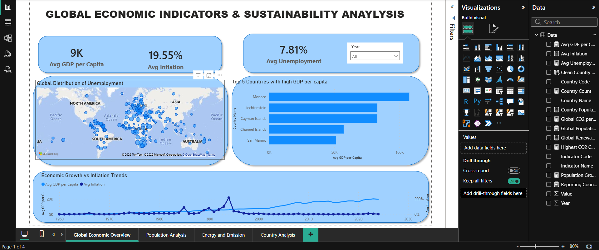

# Global Development Power BI Dashboard

An interactive Power BI report exploring economic development, population, and sustainability indicators across countries and years using World Bank World Development Indicators (WDI) data.

## Dashboard

The report contains four pages:

### 1. Global Economic Overview
Tracks GDP per capita, inflation, and unemployment over time. Small economies can rank highly on GDP per capita, so country rankings should be interpreted with population and economic context in mind.

### 2. Global Population Insights
Explores total population, population growth, and country-level population distribution.

### 3. Energy & Carbon Insights
Compares CO₂ emissions per capita with renewable-energy indicators across countries. These are descriptive comparisons and do not establish that one indicator causes another.

### 4. Country Development Profile
Allows a country to be selected for a closer look at GDP per capita, CO₂ emissions, renewable energy, and other economic indicators over time. The screenshot shows India as an example.

## Files
- **Power BI report:** [PowerBI-Main Dashboard.pbix](PowerBI-Main%20Dashboard.pbix)
- **Dataset used by the report:** [data.csv](data.csv)
- **Dataset source:** [World Bank Open Data](https://data.worldbank.org/) and the [World Development Indicators database](https://databank.worldbank.org/source/world-development-indicators)

## Tools
- Microsoft Power BI
- DAX
- Power Query
- Data visualization

## Project objective
Build a multi-page dashboard to explore country-level development indicators, compare patterns across regions and time, and support interactive exploration.

## Interpretation notes
- Indicator availability and reporting years may differ by country; comparisons should account for missing observations and different coverage.
- Aggregating country values into a “global” figure requires a deliberate choice of aggregation method. Review the report's DAX measures before interpreting global KPI cards as population-weighted or economy-weighted values.
- Relationships in the visuals are descriptive, not causal.

## Author
Sandeep Patnaik
